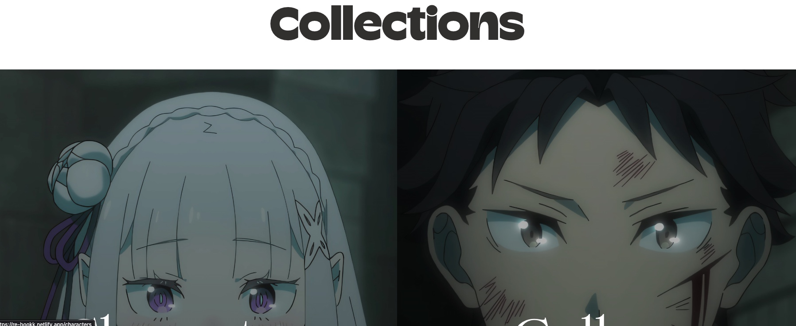
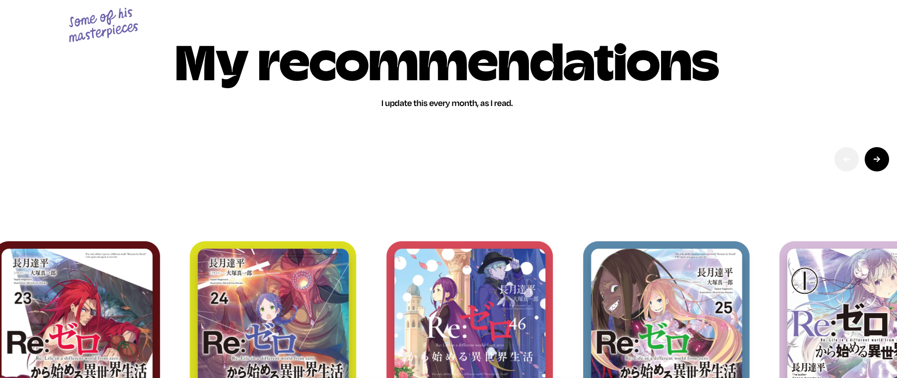
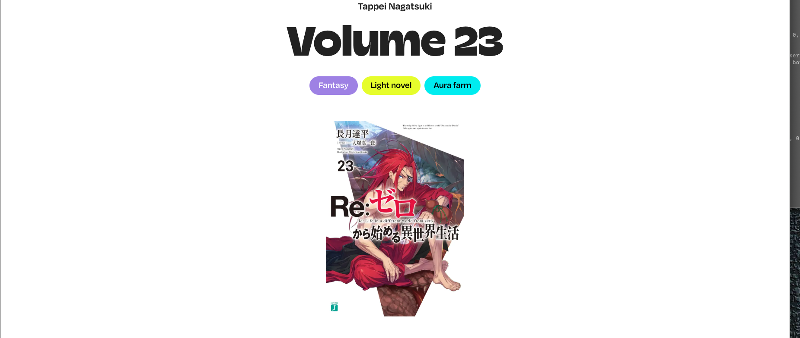

# Rebook

  

  <a href="https://github.com/he3vn/ReBook">github</a> · <a href="https://re-bookk.netlify.app/">itry</a>

   

**Re:zero glaze site.**

A rezero glaze site and a reader for anyone who wants to read a little bit of the novels,I bought the books and dumped it,I dont endorse piracy(github dont nuke my site pls).

> Made with love.

---

## Screenshots

## How I built
Rebook was built using webflow export from another site  since im not the best at css and me ovverriding that css with reboot so i was basically molding it from a base site you can check it out here:https://www.lesintranquilles.com/. and then html and js.

## thanks

assets were made taken from the anime
and thanks to claude for making the gallery/character page and helping me with research

## license

re:book is licensed under the [MIT License](LICENSE).
